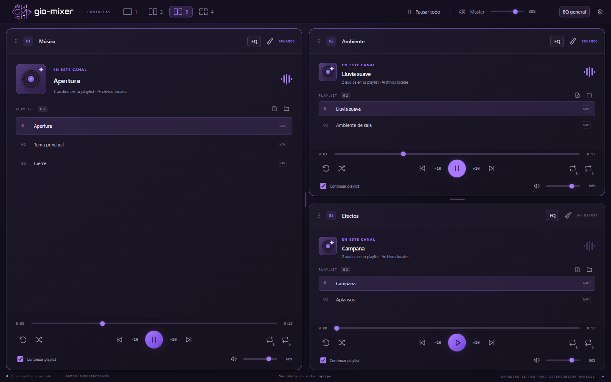
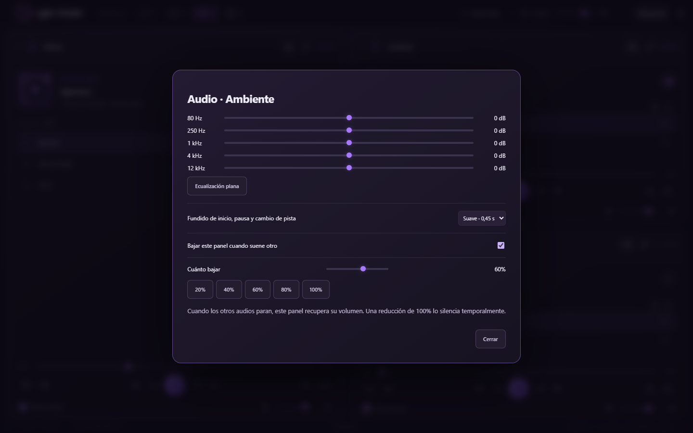
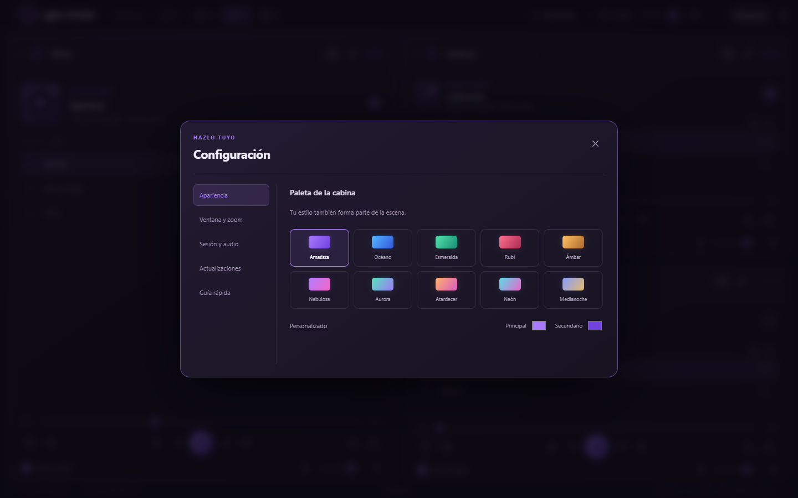

# Gio Mixer

**Mezcla música, ambiente y efectos desde una sola ventana de Windows.** Trabaja con hasta cuatro reproductores independientes y ajusta cada uno a tu ritmo, desde una playlist para una actuación hasta un panel de efectos que lanzas a mano.

**[Descargar Gio Mixer para Windows x64](https://github.com/deiviiiiiiiii/gio-mixer-releases/releases/latest)** · [Ver todas las versiones](https://github.com/deiviiiiiiiii/gio-mixer-releases/releases)

*Ejemplo con tres paneles. Música y Ambiente pueden sonar juntos mientras preparas el siguiente efecto.*

## Instalación

1. Abre la [última versión](https://github.com/deiviiiiiiiii/gio-mixer-releases/releases/latest).
2. En **Assets**, descarga el archivo que termina en **x64-setup.exe**.
3. Ejecuta el instalador y abre **Gio Mixer** desde el menú Inicio.

Si vienes de la **0.3.1 o anterior**, instala manualmente una versión **0.3.2 o posterior** una vez para activar el actualizador. Si el mixer está abierto, ciérralo antes de ejecutar el instalador. Los archivos `.sig` y `latest.json` los usa el actualizador.

## Prepara tu primera mezcla

1. **Elige una vista** de uno a cuatro paneles desde la cabecera. Con tres, el primero queda a la izquierda y los otros dos se apilan a la derecha.
2. **Carga tus audios** con **Elegir archivos**, **Elegir carpeta** o arrastrándolos a un panel. Prueba con MP3 o WAV. Puedes ajustar la inclusión de subcarpetas en **Configuración → Sesión y audio**.
3. **Organiza la cabina.** Haz clic en el nombre de un panel para editarlo. Mueve los separadores para ajustar tamaños y arrastra el asa de una cabecera a otro panel para intercambiarlos.
4. **Decide qué suena.** Haz clic en una pista para lanzarla. Si quieres disparar las pistas una por una, desactiva **Continuar playlist** en ese panel.

| Control | Qué hace |
| --- | --- |
| Reproducir / Pausar | Controla solo el audio de ese panel. |
| Reiniciar | Reproduce la pista actual desde el inicio. |
| Anterior, siguiente y saltos | Cambia de pista o retrocede y avanza unos segundos. |
| Aleatorio y repetición | Cambia el orden o repite la pista o la lista. Pulsa el botón de repetición para alternar entre apagado, una repetición adicional e indefinida. |
| Volumen y silencio | Ajusta un panel. **Master** controla la salida general y **Pausar todo** detiene los paneles que estén sonando. |
| Brocha | Tras confirmar, vacía el panel y restablece sus ajustes. Los archivos originales siguen en sus carpetas. |

**Al reducir el número de paneles**, una confirmación indica qué listas se quitarán. Al volver a ampliar la vista, esos espacios aparecen vacíos.

## Ecualización, fundidos y fondo automático

Abre **EQ** en cualquier panel para ajustar cinco bandas y elegir un fundido al iniciar, reanudar, pausar o cambiar de pista. **EQ general**, en la cabecera, se aplica a toda la mezcla.

Para que una pista de fondo ceda espacio a otra, activa **Bajar este panel cuando suene otro**. Elige una reducción rápida de **20%, 40%, 60%, 80% o 100%**, o usa el deslizador. Con una reducción del **60%**, el panel queda al **40% de su nivel habitual** mientras suenan otros audios y se recupera suavemente cuando dejan de sonar. Puedes configurar esta función en cualquiera de los paneles.

## Personaliza y guarda tu sesión

Desde el engranaje puedes elegir entre diez temas, personalizar los colores y ajustar el zoom o el estilo de ventana. En **Sesión y audio**, activa **Recordar sesión** para recuperar las listas y los ajustes al volver a abrir el mixer. Los audios recuperados arrancan en pausa.

## Actualizaciones

Gio Mixer consulta el canal al abrir y cada 30 minutos. Cuando encuentra una versión posterior, aparece **Actualizar** en la cabecera. También puedes usar **Configuración → Actualizaciones → Buscar actualizaciones**.

Instala en un momento en que puedas cerrar el mixer, porque Windows interrumpe la reproducción para completar la instalación. El actualizador verifica la firma antes de instalar.

**¿Encontraste un problema?** Cuéntanos qué versión usas, qué esperabas que ocurriera y cómo reproducirlo en [Issues](https://github.com/deiviiiiiiiii/gio-mixer-releases/issues).
